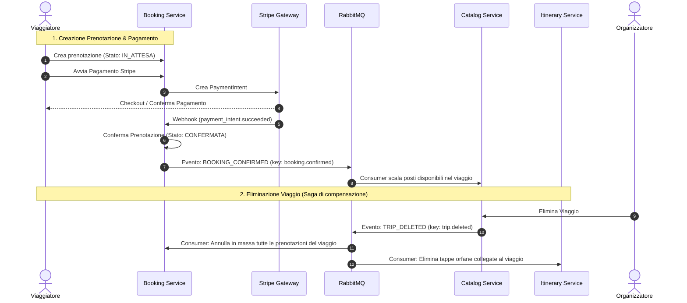

# 🌍 TripFlow — Microservices Travel Platform

**TripFlow** è una piattaforma cloud-native a **microservizi** progettata per la gestione completa dell'ecosistema dei viaggi organizzati e della pianificazione di itinerari turistici. 

Sviluppata con **Java 17**, **Spring Boot 3.5**, **Spring Cloud** e containerizzata con **Docker**, TripFlow adotta un'architettura distribuita **Event-Driven** basata su **RabbitMQ**, con autenticazione federata tramite **Keycloak (OAuth2 / OIDC)** e database relazionali isolati **PostgreSQL** (Database-per-Service Pattern).

---

## 📌 Indice

1. [Panoramica Funzionale](#-panoramica-funzionale)
2. [Architettura del Sistema](#-architettura-del-sistema)
3. [Mappa dei Microservizi e Porte](#-mappa-dei-microservizi-e-porte)
4. [Flussi Asincroni ed Event-Driven (RabbitMQ)](#-flussi-asincroni-ed-event-driven-rabbitmq)
5. [Dettaglio dei Microservizi](#-dettaglio-dei-microservizi)
6. [Sicurezza e Autenticazione (Keycloak)](#-sicurezza-e-autenticazione-keycloak)
7. [Prerequisiti e Avvio Rapido](#-prerequisiti-e-avvio-rapido)
8. [Documentazione API (Swagger / OpenAPI)](#-documentazione-api-swagger--openapi)

---

## 🎯 Panoramica Funzionale

La piattaforma modella le interazioni tra due ruoli primari:

*   🧑‍💼 **ORGANIZZATORE (`ORGANIZER`)**:
    *   Crea, aggiorna ed elimina viaggi turistici (`Trip`) specificando destinazione, date, prezzi, posti disponibili e galleria immagini (JSONB).
    *   Definisce attività correlate (`Activity`) per ciascun viaggio (escursioni, visite guidate).
    *   Monitora i posti prenotati in tempo reale.
*   🎒 **VIAGGIATORE (`TRAVELER`)**:
    *   Esplora il catalogo dei viaggi e delle attività disponibili.
    *   Crea e organizza **itinerari personalizzati** (`Itinerary`), suddividendoli in tappe (`ItineraryStop`) liberamente o agganciate a viaggi/attività.
    *   Condivide itinerari con altri viaggiatori con permessi granulari (lettura o modifica) o li rende pubblici.
    *   Effettua **prenotazioni** con blocco temporaneo dei posti (politica di TTL contro l'overbooking).
    *   Paga in sicurezza tramite **Stripe PaymentIntent** con conferma asincrona tramite webhook.
    *   Rilascia **recensioni verificate** (solo per viaggi effettivamente prenotati e confermati).

---

## 🏛 Architettura del Sistema

```mermaid
graph TD
    Client[Client / Web / Mobile App] -->|Porta 8080| GW[API Gateway Service]

    subgraph "Edge & Discovery"
        GW -->|Service Discovery| Eureka[Discovery Service - Eureka :8761]
        AuthKC[Keycloak IAM :9090]
    end

    subgraph "Microservizi di Dominio"
        GW -->|/user-auth-service/**| Auth[User Auth Service :8086]
        GW -->|/catalog-service/**| Catalog[Catalog Service :8084]
        GW -->|/booking-service/**| Booking[Booking Service :8083]
        GW -->|/itinerary-service/**| Itinerary[Itinerary Service :8087]
        GW -->|/review-service/**| Review[Review Service :8085]
    end

    subgraph "Event Bus & Storage"
        RabbitMQ[(RabbitMQ :5672)]
        PG[(PostgreSQL 16 :5433)]
        PG_KC[(PostgreSQL Keycloak :5434)]
    end

    Auth -.->|OAuth2 / Admin API| AuthKC
    Auth -->|Publish User Events| RabbitMQ
    Catalog <-->|Publish Trips / Consume Bookings| RabbitMQ
    Booking <-->|Publish Bookings / Consume Trips| RabbitMQ
    Booking -->|Feign Client| Catalog
    Booking -.->|Payment Intents & Webhooks| Stripe[Stripe API]
    Itinerary -->|Consume Trip Events| RabbitMQ
    Itinerary -->|Feign Client| Auth
    Review -->|Feign Client (Verifica Prenotazione)| Booking
    Review -->|Feign Client| Catalog

    Auth --> PG
    Catalog --> PG
    Booking --> PG
    Itinerary --> PG
    Review --> PG
    AuthKC --> PG_KC
```

---

## 🔌 Mappa dei Microservizi e Porte

Tutti i servizi registrati su **Eureka** sono accessibili all'esterno unicamente tramite il **Gateway** (porta `8080`) usando la convenzione del prefisso `/nome-servizio/**` (gestito con `StripPrefix=1`), oppure direttamente sulle porte locali in fase di sviluppo:

| Servizio | Modulo Maven | Porta Locale | Percorso su Gateway (`8080`) | Database / Storage |
| :--- | :--- | :--- | :--- | :--- |
| **Gateway Service** | `gateway-service` | `8080` | `/*` (Entrypoint WebFlux) | - |
| **Discovery Service** | `discovery-service` | `8761` | `/eureka` | In-Memory (Eureka) |
| **User Auth Service** | `user-auth-service` | `8086` | `/user-auth-service/**` | `tripflow_db` + Flyway |
| **Catalog Service** | `catalog-service` | `8084` | `/catalog-service/**` | `tripflow_catalog_db` |
| **Booking Service** | `booking-service` | `8083` | `/booking-service/**` | `tripflow_booking_db` |
| **Review Service** | `review-service` | `8085` | `/review-service/**` | `tripflow_review_db` |
| **Itinerary Service** | `itinerary-service` | `8087` | `/itinerary-service/**` | `tripflow_db` + Flyway |
| **Keycloak IAM** | Docker container | `9090` | - | `keycloak_db` (:5434) |
| **RabbitMQ Server** | Docker container | `5672` / `15672` | - | RabbitMQ Management UI |
| **PostgreSQL 16** | Docker container | `5433` | - | Multi-database instance |

---

## ⚡ Flussi Asincroni ed Event-Driven (RabbitMQ)

L'applicazione garantisce l'eventual consistency (Pattern Saga basato su coreografia) attraverso topic exchange su RabbitMQ:



### Eventi Principali Scambiati:
*   `trip.created`, `trip.updated`, `trip.deleted`: Pubblicati da **Catalog Service**. Consumati da **Booking Service** (per annullare prenotazioni attive) e da **Itinerary Service** (per cancellare tappe orfane).
*   `booking.confirmed`, `booking.cancelled`: Pubblicati da **Booking Service**. Consumati da **Catalog Service** per incrementare o decrementare in modo atomico i posti disponibili (`available_spots`).
*   `user.registered`, `user.updated`, `user.deleted`: Pubblicati da **User Auth Service** per sincronizzare anagrafiche e stati utente negli altri servizi.

---

## 📦 Dettaglio dei Microservizi

### 1. `gateway-service`
*   Reverse Proxy asincrono non bloccante basato su **Spring Cloud Gateway (WebFlux)**.
*   Configurazione CORS centralizzata (`globalcors`).
*   Inoltro dinamico delle richieste tramite Eureka (`lb://<service-name>`).
*   Swagger UI unificato che aggrega le OpenAPI specs di tutti i microservizi.

### 2. `discovery-service`
*   Server di Service Discovery **Spring Cloud Netflix Eureka**.
*   Heartbeat periodici per monitoraggio dell'health status delle istanze.

### 3. `user-auth-service`
*   Gestione credenziali e profili utente in combinazione con **Keycloak**.
*   **Verifica email con OTP**: alla registrazione l'utente riceve via mail un codice a 6 cifre; il login resta bloccato (403) finché l'email non è verificata.
*   **Reset password con OTP**: `forgot-password` invia un codice via mail, `reset-password` lo valida e imposta la nuova password.
*   **Email di compleanno**: job schedulato giornaliero che invia un augurio con un codice sconto del 15% valido 2 settimane (codice dimostrativo, non ancora riscattabile al checkout).
*   Le email applicative passano da un server SMTP (in sviluppo **Mailpit**, UI su `http://localhost:8025`).
*   **Endpoint principali**:
    *   `POST /api/auth/register`: Registrazione con ruolo (`TRAVELER`/`ORGANIZER`), creazione account Keycloak, sincronizzazione DB locale e invio del codice di verifica. Rate limiting (5 richieste/minuto).
    *   `POST /api/auth/verify-email`, `POST /api/auth/resend-verification`: Verifica email tramite codice OTP e reinvio del codice.
    *   `POST /api/auth/login`: Autenticazione (Resource Owner Password Credentials contro Keycloak) con rilascio di Access e Refresh Token. Bloccata se l'email non è verificata.
    *   `POST /api/auth/refresh`: Refresh del token JWT scaduto.
    *   `POST /api/auth/logout`: Revoca del refresh token (RFC 7009).
    *   `POST /api/auth/forgot-password`, `POST /api/auth/reset-password`: Recupero password tramite codice OTP.
    *   `GET /api/auth/me`, `PUT /api/auth/me`: Visualizzazione e aggiornamento anagrafica.
    *   `PUT /api/auth/me/password`: Cambio password (richiede la password attuale per conferma).
    *   `POST /api/auth/me/avatar`: Upload dell'avatar con validazione tipo (JPEG/PNG/WebP, max 5MB).
    *   `DELETE /api/auth/me`: Eliminazione account (DB locale + Keycloak + evento RabbitMQ).
    *   `POST /api/auth/users/lookup-by-ids`: Lookup utenti inter-servizio per Keycloak ID.

### 4. `catalog-service`
*   Gestione dell'offerta turistica.
*   **Modelli**:
    *   `Trip`: Destinazione, intervallo date, quota base, posti massimi, posti prenotati, elenco immagini in formato JSONB, organizzatore di riferimento.
    *   `Activity`: Attività secondarie o escursioni opzionali con prezzi, durata e capienza specifica.
*   **Endpoint principali**:
    *   `GET /api/v1/trips`: Ricerca e consultazione catalogo con filtri.
    *   `POST /api/v1/trips`, `PUT /api/v1/trips/{id}`, `DELETE /api/v1/trips/{id}`: Gestione viaggi (riservato agli `ORGANIZER`).
    *   `POST /api/v1/activities`, `PUT /api/v1/activities/{id}`: Gestione attività.

### 5. `booking-service`
*   Gestione del flusso d'acquisto, emissione ordini e integrazione monetaria.
*   **Caratteristiche distintive**:
    *   **Gestione TTL**: Le prenotazioni create hanno stato iniziale `IN_ATTESA`. Un thread programmato (`@Scheduled`) libera i posti se il pagamento non viene finalizzato entro una finestra temporale (es. 10 minuti).
    *   **Integrazione Stripe**: Generazione `PaymentIntent` e ricezione webhook idempotente per il passaggio a `CONFERMATA`.
*   **Endpoint principali**:
    *   `POST /api/prenotazioni`: Creazione ordine di prenotazione con validazione disponibilità posti via Feign verso Catalog Service.
    *   `GET /api/prenotazioni/mie`, `GET /api/prenotazioni/mie/attive`: Storico prenotazioni dell'utente.
    *   `POST /api/pagamenti/{prenotazioneId}`: Inizializzazione transazione Stripe.
    *   `POST /api/pagamenti/webhook`: Webhook listener per notifica di successo/fallimento da Stripe.

### 6. `itinerary-service`
*   Creazione e condivisione di road-trip, piani di viaggio e itinerari giornalieri.
*   **Modelli**:
    *   `Itinerary`: Titolo, descrizione, date e visibilità (`PRIVATE`, `PUBLIC`, `SHARED`).
    *   `ItineraryStop`: Singola tappa con ordine cronologico, riferimenti opzionali a `Trip` o `Activity` oppure tappe custom con coordinate e orari.
    *   `ItineraryShare`: Condivisione con specifici utenti con flag `canEdit`.
*   **Endpoint principali**:
    *   `POST /api/itineraries`, `GET /api/itineraries`, `GET /api/itineraries/{id}`: Gestione e recupero itinerari accessibili.
    *   `POST /api/itineraries/{id}/stops`, `PUT /api/itineraries/{id}/stops/{stopId}`: Aggiunta e riordino tappe.
    *   `POST /api/itineraries/{id}/shares`: Condivisione con un altro utente (validato tramite `UserAuthClient`).

### 7. `review-service`
*   Feedback e reputazione.
*   **Regole di business**:
    *   Per lasciare una recensione a un viaggio, il servizio effettua una chiamata Feign a **Booking Service** per verificare che esista una prenotazione confermata per l'utente richiedente.
    *   Snapshot immutabile del nome dell'oggetto e dell'autore all'atto della recensione.
    *   Vincolo di unicità: una recensione per coppia (viaggiatore, oggetto).
    *   Finestra temporale massima di modifica (es. 30 giorni dalla pubblicazione).
*   **Endpoint principali**:
    *   `POST /api/recensioni`: Creazione recensione.
    *   `GET /api/recensioni/oggetto/{id}`: Consultazione recensioni per viaggio/entità.
    *   `GET /api/recensioni/mie`: Recensioni create dal viaggiatore autenticato.

---

## 🔒 Sicurezza e Autenticazione (Keycloak)

L'architettura adotta lo standard **OAuth 2.0 / OpenID Connect**:
*   Tutti i microservizi di backend agiscono come **OAuth2 Resource Server**, convalidando i token JWT emessi dal realm `tripflow` di Keycloak tramite endpoint JWKS (`/protocol/openid-connect/certs`).
*   I ruoli utente (`TRAVELER`, `ORGANIZER`) sono mappati nei token JWT e valutati tramite annotazioni `@PreAuthorize("hasRole('ORGANIZER')")` o utility di sicurezza custom (`SecurityUtils`).
*   Il file `compose.yaml` avvia Keycloak con realm preconfigurato importato automaticamente da `./keycloak/realm-export.json`.
*   Il realm abilita la **protezione brute-force** (blocco temporaneo dopo 5 tentativi di login falliti) e una **password policy** minima (lunghezza ≥ 8). NB: queste impostazioni vengono applicate solo al primo import del realm; su un volume Keycloak già esistente vanno abilitate dalla console admin o rigenerando il volume.
*   **Verifica email** e **reset password** sono gestiti internamente da `user-auth-service` tramite codici OTP via email, non dai flussi email nativi di Keycloak.

---

## 🚀 Prerequisiti e Avvio Rapido

### 1. Prerequisiti
*   **Java 17** (JDK)
*   **Maven 3.8+** (o utilizzo dei wrapper `mvnw` inclusi)
*   **Docker** & **Docker Compose**

### 2. Avvio dell'Infrastruttura (Docker Compose)
Dalla radice del progetto:

```bash
docker compose up -d
```

Questo comando avvia:
*   PostgreSQL per i microservizi (`localhost:5433`) con script di creazione DB automatici (`./postgres-init/init-databases.sql`).
*   PostgreSQL per Keycloak (`localhost:5434`).
*   Keycloak IAM (`http://localhost:9090` - credenziali admin: `admin` / `admin`).
*   RabbitMQ (`localhost:5672` con console su `http://localhost:15672` - `guest` / `guest`).

### 3. Build del Progetto
Per compilare tutti i microservizi dal pom radice:

```bash
./mvnw clean install -DskipTests
```

### 4. Avvio dei Servizi (Ordine Consigliato)
È consigliabile avviare i servizi in questo ordine:
1. `discovery-service` (Eureka su porta `8761`)
2. `gateway-service` (Gateway su porta `8080`)
3. `user-auth-service` (porta `8086`)
4. `catalog-service` (porta `8084`)
5. `booking-service` (porta `8083`)
6. `itinerary-service` (porta `8087`)
7. `review-service` (porta `8085`)

Ogni servizio può essere avviato tramite il comando Maven Spring Boot:
```bash
# Esempio per avviare il discovery service
cd discovery-service
../mvnw spring-boot:run
```

---

## 📖 Documentazione API (Swagger / OpenAPI)

Una volta avviato il **Gateway Service** e i singoli microservizi, l'interfaccia interattiva Swagger UI è accessibile all'indirizzo:

📍 **[http://localhost:8080/swagger-ui.html](http://localhost:8080/swagger-ui.html)**

Dal menu a tendina in alto a destra su Swagger UI è possibile selezionare le specifiche OpenAPI di ciascun microservizio:
*   **Booking Service** (`/booking-service/v3/api-docs`)
*   **Catalog Service** (`/catalog-service/v3/api-docs`)
*   **User Auth Service** (`/user-auth-service/v3/api-docs`)
*   **Itinerary Service** (`/itinerary-service/v3/api-docs`)
*   **Review Service** (`/review-service/v3/api-docs`)

---

## 👨‍💻 Autori & Licenza
Sviluppato come progetto per l'Università della Calabria (UNICAL).
Distribuito con licenza accademica / open-source.