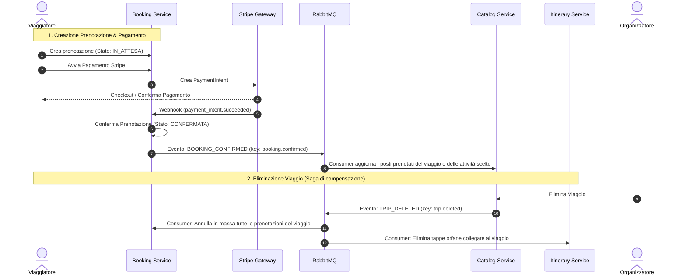

#  TripFlow — Piattaforma di Viaggi a Microservizi

**TripFlow** è una piattaforma cloud-native a **microservizi** progettata per la gestione completa dell'ecosistema dei viaggi organizzati e della pianificazione di itinerari turistici. 

Sviluppata con **Java 17**, **Spring Boot 3.5**, **Spring Cloud** e containerizzata con **Docker**, TripFlow adotta un'architettura distribuita **Event-Driven** basata su **RabbitMQ**, con autenticazione federata tramite **Keycloak (OAuth2 / OIDC)** e database relazionali isolati **PostgreSQL** (Database-per-Service Pattern).

Il frontend è un'app Android nativa, nel repository **[TripFlow-Android](https://github.com/francescomolinaroo/TripFlow-Android)**.

---

## Indice

1. [Panoramica Funzionale](#-panoramica-funzionale)
2. [Mappa dei Microservizi e Porte](#-mappa-dei-microservizi-e-porte)
3. [Flussi Asincroni ed Event-Driven (RabbitMQ)](#-flussi-asincroni-ed-event-driven-rabbitmq)
4. [Dettaglio dei Microservizi](#-dettaglio-dei-microservizi)
5. [Sicurezza e Autenticazione (Keycloak)](#-sicurezza-e-autenticazione-keycloak)
6. [Prerequisiti e Avvio Rapido](#-prerequisiti-e-avvio-rapido)
7. [Pagamenti con Stripe (modalità test)](#-pagamenti-con-stripe-modalità-test)
8. [Provare l'App Android](#-provare-lapp-android)
9. [Documentazione API (Swagger / OpenAPI)](#-documentazione-api-swagger--openapi)

---

## Panoramica Funzionale

La piattaforma modella le interazioni tra due ruoli primari:

*   **ORGANIZZATORE (`ORGANIZER`)**:
    *   Crea, aggiorna ed elimina viaggi turistici (`Trip`) specificando destinazione, date, prezzi, posti disponibili e galleria immagini (JSONB).
    *   Definisce attività correlate (`Activity`) per ciascun viaggio (escursioni, visite guidate), ognuna con i propri posti.
    *   Monitora le prenotazioni ricevute, i posti rimasti e l'incasso.
*    **VIAGGIATORE (`TRAVELER`)**:
    *   Esplora il catalogo dei viaggi e delle attività disponibili.
    *   Crea e organizza **itinerari personalizzati** (`Itinerary`), suddividendoli in tappe (`ItineraryStop`) liberamente o agganciate a viaggi/attività.
    *   Condivide itinerari con altri viaggiatori con permessi granulari (lettura o modifica) o li rende pubblici.
    *   Effettua **prenotazioni** con blocco temporaneo dei posti (politica di TTL contro l'overbooking).
    *   Paga in sicurezza tramite **Stripe PaymentIntent** con conferma asincrona tramite webhook, anche con il **codice sconto di compleanno** (`BDAY15`, -15%).
    *   Rilascia **recensioni verificate** (solo per viaggi prenotati e completati).

---

##  Mappa dei Microservizi e Porte

Tutti i servizi registrati su **Eureka** sono accessibili all'esterno unicamente tramite il **Gateway** (porta `8080`) usando la convenzione del prefisso `/nome-servizio/**` (gestito con `StripPrefix=1`), oppure direttamente sulle porte locali in fase di sviluppo:

| Servizio | Modulo Maven | Porta Locale | Percorso su Gateway (`8080`) | Database / Storage |
| :--- | :--- | :--- | :--- | :--- |
| **Gateway Service** | `gateway-service` | `8080` | `/*` (Entrypoint WebFlux) | - |
| **Discovery Service** | `discovery-service` | `8761` | `/eureka` | In-Memory (Eureka) |
| **User Auth Service** | `user-auth-service` | `8086` (in Docker solo rete interna) | `/user-auth-service/**` | `tripflow_user_db` + Flyway |
| **Catalog Service** | `catalog-service` | `8084` | `/catalog-service/**` | `tripflow_catalog_db` |
| **Booking Service** | `booking-service` | `8083` | `/booking-service/**` | `tripflow_booking_db` |
| **Review Service** | `review-service` | `8085` | `/review-service/**` | `tripflow_review_db` |
| **Itinerary Service** | `itinerary-service` | `8087` | `/itinerary-service/**` | `tripflow_db` + Flyway |
| **Keycloak IAM** | Docker container | `9090` | - | `keycloak_db` (:5434) |
| **RabbitMQ Server** | Docker container | `5672` / `15672` | - | RabbitMQ Management UI |
| **PostgreSQL 16** | Docker container | `5433` | - | Multi-database instance |
| **Mailpit** | Docker container | `1025` (SMTP) / `8025` (UI) | - | Email di sviluppo (codici OTP, compleanno) |

In Docker la porta di `user-auth-service` non è pubblicata: si passa sempre dal Gateway, così il rate limit legge un `X-Forwarded-For` affidabile.

---

##  Flussi Asincroni ed Event-Driven (RabbitMQ)

L'applicazione garantisce l'eventual consistency (Pattern Saga basato su coreografia) attraverso topic exchange su RabbitMQ:



### Eventi Principali Scambiati:
*   `trip.created`, `trip.updated`, `trip.deleted`: Pubblicati da **Catalog Service**. `trip.deleted` è consumato da **Booking Service** (annulla le prenotazioni in attesa o confermate del viaggio; quelle completate restano) e da **Itinerary Service** (cancella le tappe orfane).
*   `booking.confirmed`, `booking.cancelled`: Pubblicati da **Booking Service** con viaggio, numero di partecipanti e attività scelte. Consumati da **Catalog Service**, che aggiorna i posti prenotati (`booked_spots`) del viaggio e di ciascuna attività. `booking.cancelled` viene inviato solo per prenotazioni già confermate.
*   `user.registered`, `user.updated`, `user.deleted`: Pubblicati da **User Auth Service**. Al momento nessun altro servizio li consuma: booking e review salvano il nome dell'utente dal token al momento dell'operazione.

---

##  Dettaglio dei Microservizi

### 1. `gateway-service` (Tutti gli autori)
*   Reverse Proxy asincrono non bloccante basato su **Spring Cloud Gateway (WebFlux)**.
*   Configurazione CORS centralizzata (`globalcors`).
*   Inoltro dinamico delle richieste tramite Eureka (`lb://<service-name>`).
*   Swagger UI unificato che aggrega le OpenAPI specs di tutti i microservizi.

### 2. `discovery-service` (Francesco Molinaro)
*   Server di Service Discovery **Spring Cloud Netflix Eureka**.
*   Heartbeat periodici per monitoraggio dell'health status delle istanze.

### 3. `user-auth-service` (Alessandro Taverniti e relativa parte frontend user-auth)
*   Gestione credenziali e profili utente in combinazione con **Keycloak**.
*   **Verifica email con OTP**: alla registrazione l'utente riceve via mail un codice a 6 cifre; il login resta bloccato (403) finché l'email non è verificata.
*   **Reset password con OTP**: `forgot-password` invia un codice via mail, `reset-password` lo valida e imposta la nuova password.
*   **Email di compleanno**: job schedulato giornaliero (ore 8, Europe/Rome) che invia un augurio con il codice sconto `BDAY15` (-15%), riscattabile al pagamento in `booking-service`. Il codice vale dal giorno del compleanno ai 7 giorni successivi, una volta per compleanno, e solo se la data di nascita è stata inserita almeno 30 giorni prima. La data di nascita non è modificabile dopo l'inserimento.
*   Le email applicative passano da un server SMTP (in sviluppo **Mailpit**, UI su `http://localhost:8025`).
*   **Endpoint principali**:
    *   `POST /api/auth/register`: Registrazione con ruolo (`TRAVELER`/`ORGANIZER`), creazione account Keycloak, sincronizzazione DB locale e invio del codice di verifica. Rate limiting (5 richieste/minuto).
    *   `POST /api/auth/verify-email`, `POST /api/auth/resend-verification`: Verifica email tramite codice OTP e reinvio del codice.
    *   `POST /api/auth/login`: Autenticazione (Resource Owner Password Credentials contro Keycloak) con rilascio di Access e Refresh Token. Bloccata se l'email non è verificata.
    *   `POST /api/auth/refresh`: Refresh del token JWT scaduto.
    *   `POST /api/auth/logout`: Revoca del refresh token (RFC 7009).
    *   `POST /api/auth/forgot-password`, `POST /api/auth/reset-password`: Recupero password tramite codice OTP.
    *   `GET /api/auth/me`, `PUT /api/auth/me`: Visualizzazione e aggiornamento anagrafica.
    *   `PUT /api/auth/me/password`: Cambio password (richiede la password attuale per conferma).
    *   `POST /api/auth/me/avatar`: Upload dell'avatar con validazione tipo (JPEG/PNG/WebP, max 5MB).
    *   `DELETE /api/auth/me`: Eliminazione account (DB locale + Keycloak + evento RabbitMQ).
    *   `GET /api/auth/me/birthday-coupon`: Verifica se l'utente può usare il codice di compleanno (usato da `booking-service`).
    *   `POST /api/auth/users/lookup-by-ids`: Lookup utenti inter-servizio per Keycloak ID.

### 4. `catalog-service` (Umberto Messina e relativa parte frontend catalog)
*   Gestione dell'offerta turistica.
*   **Modelli**:
    *   `Trip`: Destinazione, intervallo date, quota base, posti massimi, posti prenotati, elenco immagini in formato JSONB, organizzatore di riferimento.
    *   `Activity`: Attività secondarie o escursioni opzionali con prezzi, durata, capienza specifica e posti prenotati.
*   **Posti**: nelle risposte `availableSpots` sono i posti **rimasti** (capienza meno prenotati) e `totalSpots` la capienza dichiarata, sia per i viaggi sia per le attività. I posti prenotati si aggiornano con gli eventi `booking.confirmed` / `booking.cancelled`.
*   **Regole di business**: la data di inizio non può essere nel passato e la data di fine deve seguire quella di inizio; un'attività non può avere più posti di quelli ancora liberi nel viaggio.
*   **Endpoint principali**:
    *   `GET /api/v1/trips`, `GET /api/v1/trips/{id}`, `GET /api/v1/trips/search`: Consultazione e ricerca del catalogo (destinazione, date, prezzo, posti liberi). Pubblici.
    *   `POST /api/v1/trips`, `PUT /api/v1/trips/{id}`, `DELETE /api/v1/trips/{id}`: Gestione viaggi (riservato agli `ORGANIZER`).
    *   `GET /api/v1/trips/organizer/{organizerId}`: Viaggi di un organizzatore.
    *   `POST /api/v1/activities`, `PUT /api/v1/activities/{id}`, `DELETE /api/v1/activities/{id}`: Gestione attività.
    *   `GET /api/v1/activities/{id}`, `GET /api/v1/activities/trip/{tripId}`, `GET /api/v1/activities/search`: Consultazione attività.

### 5. `booking-service` (Francesco Molinaro e relativa parte frontend booking)
*   Gestione del flusso d'acquisto, emissione ordini e integrazione monetaria.
*   **Caratteristiche distintive**:
    *   **Ciclo di vita**: `IN_ATTESA` → `CONFERMATA` (pagamento riuscito) → `COMPLETATA` (job notturno alle 3:00, dopo la data di fine del viaggio). In alternativa `ANNULLATA`.
    *   **Gestione TTL**: Le prenotazioni `IN_ATTESA` bloccano i posti per 10 minuti (`booking.prenotazione.ttl`); un job programmato le annulla se il pagamento non arriva in tempo.
    *   **Controllo posti**: alla creazione, e quando si aggiunge un'attività, booking conta i posti occupati (confermati più quelli in attesa non scaduti) per il viaggio e per ogni attività, con un lock per viaggio contro le prenotazioni concorrenti.
    *   **Integrazione Stripe**: Generazione `PaymentIntent` e ricezione webhook idempotente per il passaggio a `CONFERMATA`. Un pagamento fallito può essere ritentato sullo stesso `PaymentIntent`.
    *   **Codice sconto**: al pagamento si può indicare `BDAY15`; booking verifica l'idoneità su `user-auth-service` e calcola l'importo scontato.
    *   **Annullamento**: una prenotazione confermata annullata risulta `RIMBORSATO` nell'app; il rimborso è solo applicativo e Stripe non viene chiamato.
*   **Endpoint principali**:
    *   `POST /api/prenotazioni`: Creazione prenotazione con validazione dei posti di viaggio e attività.
    *   `GET /api/prenotazioni/{id}`, `GET /api/prenotazioni/mie`, `GET /api/prenotazioni/mie/attive`: Dettaglio e storico prenotazioni dell'utente.
    *   `PATCH /api/prenotazioni/{id}/annulla`: Annullamento.
    *   `POST /api/prenotazioni/{id}/attivita`, `DELETE /api/prenotazioni/{id}/attivita/{attivitaId}`: Aggiunta e rimozione di attività su una prenotazione in attesa.
    *   `GET /api/prenotazioni/cerca`, `GET /api/prenotazioni/viaggio/{viaggioId}`: Prenotazioni ricevute dall'organizzatore.
    *   `POST /api/pagamenti/{prenotazioneId}`: Inizializzazione transazione Stripe (body opzionale `{"codiceSconto": "BDAY15"}`).
    *   `GET /api/pagamenti/{prenotazioneId}`: Stato del pagamento.
    *   `POST /api/pagamenti/webhook`: Webhook listener per notifica di successo/fallimento da Stripe.

### 6. `itinerary-service` (Mattia Taccone e relativa parte frontend itinerary)
*   Creazione e condivisione di road-trip, piani di viaggio e itinerari giornalieri.
*   **Modelli**:
    *   `Itinerary`: Titolo, descrizione, date e visibilità (`PRIVATE`, `PUBLIC`, `SHARED`).
    *   `ItineraryStop`: Singola tappa con ordine cronologico, riferimenti opzionali a `Trip` o `Activity` oppure tappe custom con coordinate e orari.
    *   `ItineraryShare`: Condivisione con specifici utenti con flag `canEdit`.
*   **Endpoint principali**:
    *   `POST /api/itineraries`, `GET /api/itineraries`, `GET /api/itineraries/{id}`, `PUT /api/itineraries/{id}`, `DELETE /api/itineraries/{id}`: Gestione e recupero itinerari accessibili.
    *   `PATCH /api/itineraries/{id}/visibility`: Cambio di visibilità.
    *   `POST /api/itineraries/{id}/stops`, `PUT /api/itineraries/{id}/stops/{stopId}`, `DELETE /api/itineraries/{id}/stops/{stopId}`: Gestione e riordino tappe. Le tappe collegate a viaggi o attività vengono verificate su `catalog-service`.
    *   `POST /api/itineraries/{id}/shares`, `GET /api/itineraries/{id}/shares`, `DELETE /api/itineraries/{id}/shares/{sharedWithUserId}`: Condivisione con un altro utente, identificato dal suo codice utente (Keycloak ID) e validato su `user-auth-service`.
    *   `GET /api/itineraries/public/{token}`: Lettura pubblica di un itinerario reso pubblico.

### 7. `review-service` (Francesco Molinaro e relativa parte frontend review)
*   Feedback e reputazione.
*   **Regole di business**:
    *   Per lasciare una recensione a un viaggio, il servizio effettua una chiamata Feign a **Booking Service** per verificare che l'utente sia il titolare di una prenotazione in stato `COMPLETATA`.
    *   Snapshot immutabile del nome dell'oggetto e dell'autore all'atto della recensione.
    *   Vincolo di unicità: una recensione per coppia (viaggiatore, oggetto).
    *   Modifica consentita entro 30 giorni dalla pubblicazione (`tripflow.review.modifica-entro-giorni`).
*   **Endpoint principali**:
    *   `POST /api/recensioni`, `PUT /api/recensioni/{id}`, `DELETE /api/recensioni/{id}`: Creazione, modifica ed eliminazione.
    *   `GET /api/recensioni/puo-recensire`: Verifica se una prenotazione può essere recensita.
    *   `GET /api/recensioni/oggetto/{oggettoId}`, `GET /api/recensioni/oggetto/{oggettoId}/media`, `GET /api/recensioni/oggetto/{oggettoId}/conta`: Recensioni, media e numero per un viaggio.
    *   `GET /api/recensioni/mie`: Recensioni create dal viaggiatore autenticato.

---

##  Sicurezza e Autenticazione (Keycloak)

L'architettura adotta lo standard **OAuth 2.0 / OpenID Connect**:
*   Tutti i microservizi di backend agiscono come **OAuth2 Resource Server**, convalidando i token JWT emessi dal realm `tripflow` di Keycloak tramite endpoint JWKS (`/protocol/openid-connect/certs`).
*   I ruoli utente (`TRAVELER`, `ORGANIZER`) sono mappati nei token JWT e valutati tramite annotazioni `@PreAuthorize("hasRole('ORGANIZER')")` o utility di sicurezza custom (`SecurityUtils`).
*   Il file `compose.yaml` avvia Keycloak con realm preconfigurato importato automaticamente da `./keycloak/realm-export.json`.
*   Il realm abilita la **protezione brute-force** (blocco temporaneo dopo 5 tentativi di login falliti) e una **password policy** minima (lunghezza ≥ 8). NB: queste impostazioni vengono applicate solo al primo import del realm; su un volume Keycloak già esistente vanno abilitate dalla console admin o rigenerando il volume.
*   **Verifica email** e **reset password** sono gestiti internamente da `user-auth-service` tramite codici OTP via email, non dai flussi email nativi di Keycloak.
*   L'access token dura 5 minuti: l'app Android lo rinnova in automatico con `POST /api/auth/refresh` quando riceve un 401, senza riportare l'utente al login.

---

##  Prerequisiti e Avvio Rapido

### 1. Prerequisiti
*   **Docker** & **Docker Compose** (per l'avvio completo).
*   **Java 17** e **Maven 3.8+** (o i wrapper `mvnw` inclusi), solo per sviluppare o lanciare i servizi fuori da Docker.
*   **Stripe CLI**, solo per provare i pagamenti (vedi la [sezione dedicata](#-pagamenti-con-stripe-modalità-test)).

### 2. Avvio completo con Docker Compose
Dalla radice del progetto:

```bash
docker compose up -d --build
```

Il comando compila e avvia tutti e 7 i microservizi più l'infrastruttura:
*   PostgreSQL per i microservizi (`localhost:5433`), con i database creati da `./postgres-init/init-databases.sql`.
*   PostgreSQL per Keycloak (`localhost:5434`).
*   Keycloak IAM (`http://localhost:9090`, admin: `admin` / `admin`) con il realm `tripflow` importato.
*   RabbitMQ (`localhost:5672`, console su `http://localhost:15672`, `guest` / `guest`).
*   Mailpit (`http://localhost:8025`): qui arrivano le email con i codici OTP di verifica e di reset password.
*   Eureka (`http://localhost:8761`) e il Gateway (`http://localhost:8080`), unico punto d'ingresso per l'app.

Il primo avvio richiede qualche minuto. I servizi sono pronti quando compaiono tutti e 6 su Eureka (gateway e i 5 servizi di dominio). Tutti i container girano con fuso orario `Europe/Rome`, quindi gli orari mostrati nell'app sono quelli italiani.

Per fermare tutto senza perdere i dati:

```bash
docker compose stop
```

 Lo script `postgres-init` viene eseguito solo alla creazione del volume. Su un volume PostgreSQL già esistente i database mancanti vanno creati a mano, oppure si ricrea il volume con `docker compose down -v` (che **cancella tutti i dati**, utenti Keycloak inclusi).

### 3. Sviluppo locale (servizi fuori da Docker)
Per lavorare su un singolo servizio si può avviare solo l'infrastruttura:

```bash
docker compose up -d postgresql postgres-keycloak keycloak rabbitmq mailpit discovery-service gateway-service
```

e poi lanciare i servizi da Maven, che di default usano `localhost:5433` e le altre porte locali:

```bash
./mvnw clean install -DskipTests
cd catalog-service
../mvnw spring-boot:run
```

---

##  Pagamenti con Stripe (modalità test)

I pagamenti usano Stripe in **modalità test**: nessuna carta vera e nessun addebito. Ognuno usa il proprio account Stripe gratuito. La configurazione si fa una volta sola e richiede circa 10 minuti.

### 1. Account e chiavi
1. Registrarsi su [dashboard.stripe.com/register](https://dashboard.stripe.com/register); non serve attivare l'account per i pagamenti reali.
2. Verificare che in alto sia attiva la **modalità test** (Test mode).
3. Da **Sviluppatori → Chiavi API** copiare la chiave pubblicabile `pk_test_...` e la chiave segreta `sk_test_...`.

### 2. File con le chiavi
Creare il file `booking-service/.env.stripe`:

```
STRIPE_SECRET_KEY=sk_test_...
STRIPE_PUBLISHABLE_KEY=pk_test_...
```

Il file è nel `.gitignore`: **non va committato** e le chiavi non vanno condivise. L'app non richiede configurazione, perché riceve la chiave pubblicabile dal backend.

### 3. Stripe CLI
*   macOS: `brew install stripe/stripe-cli/stripe`
*   Windows / Linux: [docs.stripe.com/stripe-cli](https://docs.stripe.com/stripe-cli)

Poi `stripe login`, con lo stesso account del punto 1.

### 4. Avvio del backend con il segreto del webhook
Dalla radice del progetto:

```bash
export STRIPE_WEBHOOK_SECRET=$(stripe listen --print-secret)
docker compose up -d --build
```

Su Windows (PowerShell): `$env:STRIPE_WEBHOOK_SECRET = stripe listen --print-secret`.

Se `booking-service` era già avviato senza il segreto, va ricreato dopo l'export con `docker compose up -d booking-service`.

### 5. Inoltro del webhook
In un secondo terminale, da lasciare aperto durante le prove:

```bash
stripe listen --forward-to localhost:8080/booking-service/api/pagamenti/webhook --events payment_intent.succeeded,payment_intent.payment_failed
```

È il webhook a confermare la prenotazione: senza questo comando il pagamento riesce su Stripe ma la prenotazione resta `IN_ATTESA`. Per ogni pagamento nel terminale deve comparire una riga `[200] POST .../webhook`.

### 6. Pagare dall'app
Prenotare un viaggio, toccare **Paga**, scegliere **Card** e usare una carta di test. Scadenza, CVC e CAP possono essere qualsiasi, purché la scadenza sia futura (es. `12/30`, `123`, `10001`).

| Carta | Risultato |
| :--- | :--- |
| `4242 4242 4242 4242` | Pagamento riuscito → prenotazione `CONFERMATA` |
| `4000 0000 0000 0002` | Carta rifiutata (si può riprovare con un'altra) |
| `4000 0025 0000 3155` | Richiede la verifica 3D Secure |

I pagamenti di prova sono visibili nella dashboard Stripe, in modalità test, alla voce **Pagamenti**.

### Codice sconto di compleanno (facoltativo)
Il codice `BDAY15` va creato nel proprio account Stripe: in **Catalogo prodotti → Coupon** un coupon del 15% con durata "Una volta", e su quel coupon un **codice promozionale** `BDAY15`. Un nome diverso si può configurare con la variabile `BIRTHDAY_PROMO_CODE`.

### Problemi comuni
*   **Pagamento riuscito ma prenotazione `IN_ATTESA`**: il listener del punto 5 non è attivo, oppure `booking-service` è partito senza `STRIPE_WEBHOOK_SECRET`.
*   **Il foglio di pagamento non si apre o dà errore**: controllare le chiavi in `.env.stripe` e ricreare `booking-service`.

---

##  Provare l'App Android

L'app Android (repository [TripFlow-Android](https://github.com/francescomolinaroo/TripFlow-Android)) punta a `http://10.0.2.2:8080/`, l'indirizzo con cui l'emulatore Android raggiunge il Gateway sul computer. Va quindi provata su **emulatore**, con il backend avviato come descritto sopra.

*   **Registrazione**: il codice di verifica a 6 cifre arriva su Mailpit (`http://localhost:8025`). Lo stesso vale per il recupero password.
*   **Ruoli**: in registrazione si sceglie "Viaggio" (`TRAVELER`) oppure "Organizzo" (`ORGANIZER`). L'organizzatore crea viaggi e attività e vede le prenotazioni ricevute; il viaggiatore prenota, paga, crea itinerari e scrive recensioni.
*   **Condivisione itinerari**: il destinatario trova il proprio codice utente in *Itinerari → icona in alto*; il proprietario lo incolla in *Dettaglio itinerario → Condividi con un utente…*.
*   **Recensioni**: si possono scrivere solo su prenotazioni `COMPLETATA`, stato che il job notturno assegna dopo la data di fine del viaggio. Per provarle subito si può forzare lo stato di una prenotazione confermata:

    ```bash
    docker exec postgresql-itinerary_service psql -U tripflow_user -d tripflow_booking_db \
      -c "update prenotazione set stato='COMPLETATA' where stato='CONFERMATA'"
    ```

---

##  Documentazione API (Swagger / OpenAPI)

Con lo stack avviato, l'interfaccia interattiva Swagger UI è accessibile dal Gateway:

 **[http://localhost:8080/swagger-ui.html](http://localhost:8080/swagger-ui.html)**

Dal menu a tendina in alto a destra si scelgono le specifiche OpenAPI dei singoli microservizi: **Booking**, **Review**, **Itinerary** e **Catalog** vengono lette direttamente dalle loro porte (`8083`, `8085`, `8087`, `8084`), mentre **User Auth** passa dal Gateway (`/user-auth-service/v3/api-docs`), perché in Docker la sua porta non è pubblica.

---

##  Autori & Licenza
Sviluppato come progetto per l'Università della Calabria (UNICAL).
Autori del progetto: Francesco Molinaro, Mattia Taccone, Umberto Messina, Alessandro Taverniti.
Distribuito con licenza accademica / open-source.